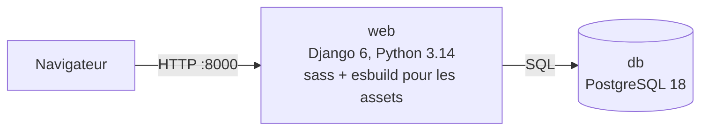
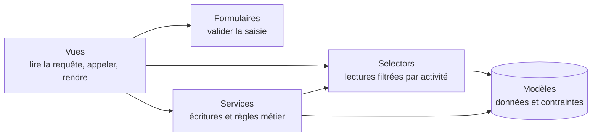
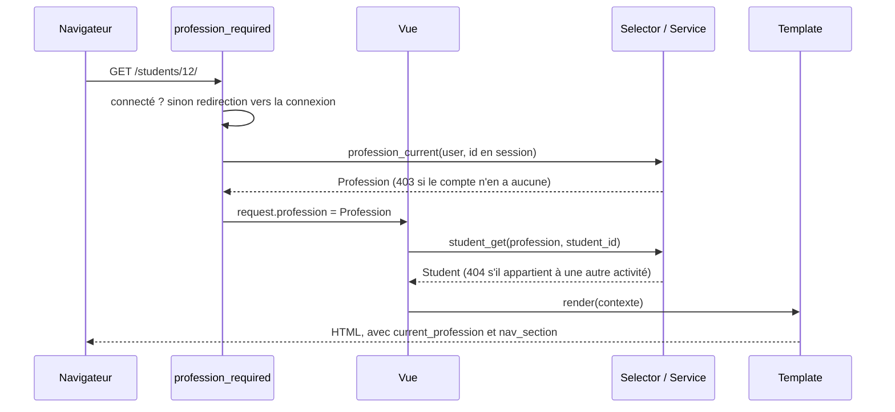

# Architecture

SoloLedger est une application Django classique, rendue côté serveur, avec HTMX pour quelques
mises à jour partielles. Une seule image Docker contient Django et l'outillage front ; la base
est PostgreSQL.



## Organisation du code

```
core/
├── config/            settings (base, development, production, test), urls, wsgi/asgi
├── apps/
│   ├── accounts/      User, Profession, LessonYear, décorateur et types de requête, seed
│   ├── students/      Plan, Payer, Student, StudentPause, PlanAssignment
│   ├── accounting/    ExpectedPayment, Payment, PaymentAllocation ; dépenses à la tranche 3
│   ├── bank_imports/  relevés bancaires (page provisoire, tranche 3)
│   └── reports/       tableau de bord, statistiques, compte d'exploitation (tranches 2 et 5)
├── utils/             helpers partagés : mois (months.py), champs de formulaire (forms.py)
├── templates/         base.html, includes/, un dossier par app
├── assets/            sources SCSS et JS
└── static/dist/       assets compilés, non versionnés
```

**Dépendances entre apps.** `accounting` connaît `students` et `accounts` (ses modèles
pointent vers eux). En sens inverse, les services de `students` et de `accounts` appellent
uniquement `expected_payments_sync` et `expected_payments_sync_for_profession`, après toute
opération qui change ce qui est dû. C'est un appel explicite plutôt qu'un signal Django : on
lit dans le service ce qu'il déclenche, et tout reste dans la même transaction. `accounting`
n'importe jamais `students.services` ni `accounts.services`, ce qui évite les imports
circulaires.

Les settings sont découpés par environnement. `manage.py` prend `development` par défaut,
pytest force `test` via `pyproject.toml`, et la production lit tout depuis l'environnement.
`DJANGO_SETTINGS_MODULE` n'est jamais écrit dans `.env` : un même `.env` sert ainsi au serveur
et aux tests sans risque de les faire tourner sur la mauvaise base.

## Couches

Le code suit le HackSoft Django Styleguide, appliqué de façon pragmatique.



| Couche      | Fichier         | Responsabilité                                                                                        | Nommage                                     |
|-------------|-----------------|-------------------------------------------------------------------------------------------------------|---------------------------------------------|
| Modèles     | `models.py`     | Champs, contraintes de base de données, `clean()` pour les règles d'un seul enregistrement, propriétés simples | `Student`, `PlanAssignment`                 |
| Selectors   | `selectors.py`  | Toute lecture non triviale. Toujours filtrée par `profession` ou par une instance déjà filtrée         | `student_list`, `lesson_year_for_month`     |
| Services    | `services.py`   | Toute écriture. Règles qui impliquent plusieurs enregistrements, transactions, journalisation           | `student_create`, `plan_assign`             |
| Formulaires | `forms.py`      | Validation de la saisie uniquement, widgets Bootstrap                                                  | `StudentForm.for_profession(...)`           |
| Vues        | `views.py`      | Fonctions courtes : lire les paramètres, appeler un selector ou un service, rendre                     | `student_detail`, `payer_plan_assign`       |

Les services et selectors n'acceptent que des arguments nommés. Les données structurées qui
passent d'une couche à l'autre sont des dataclasses gelées (`StudentListItem`), jamais des
dictionnaires.

## Cycle d'une requête

Toute page métier est décorée par `profession_required` (`accounts/decorators.py`). Le
décorateur résout l'activité courante et la pose sur la requête ; la vue ne la cherche jamais
elle-même.



`profession_current` (`accounts/selectors.py`) prend l'activité mémorisée en session si elle
appartient toujours à l'utilisateur, sinon la plus ancienne du compte. Les types
`AuthenticatedHttpRequest` et `ProfessionHttpRequest` (`accounts/types.py`) existent pour
mypy : Django passe toujours un `HttpRequest`, ils ne servent jamais à un `isinstance`.

Deux context processors complètent chaque page : `current_profession` pour l'en-tête de la
barre latérale, `navigation` qui déduit `nav_section` de l'URL résolue pour surligner le menu.

## Séparation des données

C'est la contrainte la plus importante du projet : un utilisateur ne voit jamais les données
d'un autre, même en lecture.

1. Tout enregistrement métier hérite de `ProfessionOwnedModel` et porte une clé `profession`
   (suppression protégée).
2. Chaque selector prend `profession=` et filtre dessus. Un selector peut accepter une instance
   déjà possédée (`student=`) seulement si elle vient d'un selector filtré dans la même vue.
3. Les vues ne chargent jamais un objet par son seul identifiant : `get_object_or_404` sur le
   queryset filtré, dans le selector (`student_get`, `plan_get`, `lesson_year_get`).
4. Les listes déroulantes de formulaire (`ModelChoiceField`) reçoivent leur queryset d'un
   selector filtré, via `Form.for_profession(profession, data=...)`. Un identifiant étranger
   posté devient une erreur de champ, pas une écriture.
5. Chaque fonctionnalité a un test qui prouve qu'un compte obtient 404 sur les objets d'un
   autre et qu'un identifiant étranger posté est refusé.

## Formulaires et refus métier

Les formulaires sont des `forms.Form` (pas de `ModelForm`) : la validation de saisie reste
dans le formulaire, les règles métier dans le service. Un service refuse en levant
`ValidationError` ; la vue l'attrape et l'affiche.

| Type de vue                   | En cas de refus du service                                        |
|-------------------------------|-------------------------------------------------------------------|
| Formulaire (GET + POST)       | `add_service_errors(form, error)` puis nouveau rendu du formulaire |
| Action POST seule             | `messages.error` puis redirection vers la fiche                   |

Les mois se saisissent avec `MonthField` (`core/utils/forms.py`) : deux listes déroulantes
compressées en `date(année, mois, 1)`. Les dates utilisent `<input type="date">` avec le
format ISO imposé, car le format `fr_CH` par défaut viderait le champ natif.

## Front

- **Styles** : Bootstrap 5.3.8 en SCSS, compilé par dart-sass depuis `core/assets/scss/app.scss`.
  Les montants passent par le filtre `chf` (`accounts/templatetags/money.py`) : `1’234.50 CHF`.
- **JavaScript** : un seul bundle esbuild (`core/assets/js/app.js`) qui expose Bootstrap, HTMX
  et Alpine. Alpine gère la barre latérale (repliée sur grand écran, tiroir sur mobile, état
  mémorisé dans `localStorage`). Les confirmations utilisent le modal Bootstrap par attributs
  `data-bs-*`, sans code dédié.
- **HTMX** : la liste des élèves est le modèle à suivre. La vue rend le tableau seul quand
  l'en-tête `HX-Request` vaut `true`, sauf si `HX-History-Restore-Request` l'accompagne (retour
  arrière du navigateur, qui veut la page complète). `patch_vary_headers` ajoute
  `Vary: HX-Request` pour que le cache ne confonde pas les deux. Le formulaire fonctionne
  aussi sans JavaScript : la recherche et la pagination sont de simples liens et champs GET.

## Qualité et typage

- Ruff (lint et format, ligne de 88) avec les règles `ANN` : chaque fonction est annotée,
  retour compris. Les tests en sont exemptés.
- mypy strict avec le plugin django-stubs. `django-stubs-ext` est une dépendance d'exécution
  car les settings activent le monkeypatch qui rend `ModelAdmin[Profession]` valide.
- djLint pour les templates, Prettier pour SCSS et JS, `makemigrations --check` pour les
  migrations oubliées. `make lint` enchaîne tout.
- pytest avec pytest-django et factory_boy. Les factories sont enracinées sur `profession` :
  passer `profession=` avec `student=` ou `plan=`. On appelle `Factory.create()`, pas
  `Factory()`, parce que l'appel de la métaclasse n'est pas typé.
- Les tests sont rangés par couche dans chaque app : `test_models.py`, `test_services.py`,
  `test_selectors.py`, `test_views.py`.

## Journalisation

Tout part sur la sortie standard, pour Docker, au niveau fixé par `DJANGO_LOG_LEVEL`. Chaque
module déclare `logger = logging.getLogger(__name__)`. Les services écrivent une ligne `INFO`
par opération métier avec des identifiants et des montants, jamais de nom ni d'e-mail, jamais
une ligne de relevé bancaire. Les refus métier ne sont pas journalisés : ce sont des réponses
normales, pas des anomalies.

## Environnement de développement

- `compose.yaml` décrit `web` et `db` ; `compose.dev.yaml` monte les sources et expose le port.
  `.devcontainer/` ajoute une variante où `web` ne lance pas le serveur, pour qu'une erreur de
  settings ne le fasse pas redémarrer en boucle.
- Le Dockerfile a deux étapes : `base` (Python 3.14, uv, dépendances) et `dev` qui y copie
  Node 24 depuis l'image officielle pour compiler les assets dans le même conteneur.
- Le Makefile fonctionne depuis l'hôte et depuis le conteneur : `IN_CONTAINER=1`, posé par le
  Dockerfile, bascule entre exécution directe et `docker compose exec`. Les cibles qui
  touchent la stack elle-même (`up`, `down`, `build`, `reset-db`) refusent de tourner dans le
  conteneur.
- `make seed` crée des comptes et des données ouvertement factices (préfixe `[TEST]`, e-mails
  `example.com`). La commande refuse de tourner si `SEED_ALLOWED` est faux, ce qui est le cas
  en production.

### Comptes de test

`make seed` crée trois comptes, définis dans `core/apps/accounts/management/commands/seed.py`.
Ils partagent le mot de passe `sololedger` (`SEED_PASSWORD`).

| Compte         | Rôle                                    | Activité         |
|----------------|-----------------------------------------|------------------|
| `test_guitar`  | utilisateur standard                    | Cours de guitare |
| `test_singing` | utilisateur standard                    | Cours de chant   |
| `test_admin`   | superuser technique (accès à `/admin/`) | aucune           |

Pour se connecter depuis l'hôte : `make up`, puis <http://localhost:8000> avec `test_guitar` ou
`test_singing`. Le service `web` lance déjà le serveur ; `make run` ne sert que dans le Dev
Container, où il n'est pas démarré automatiquement. Les deux comptes standard servent aussi à
vérifier à la main la séparation des données : chacun ne doit voir que sa propre activité.

Un compte qui existe déjà n'est pas recréé : relancer `make seed` ne réinitialise donc pas un
mot de passe modifié entre-temps.
