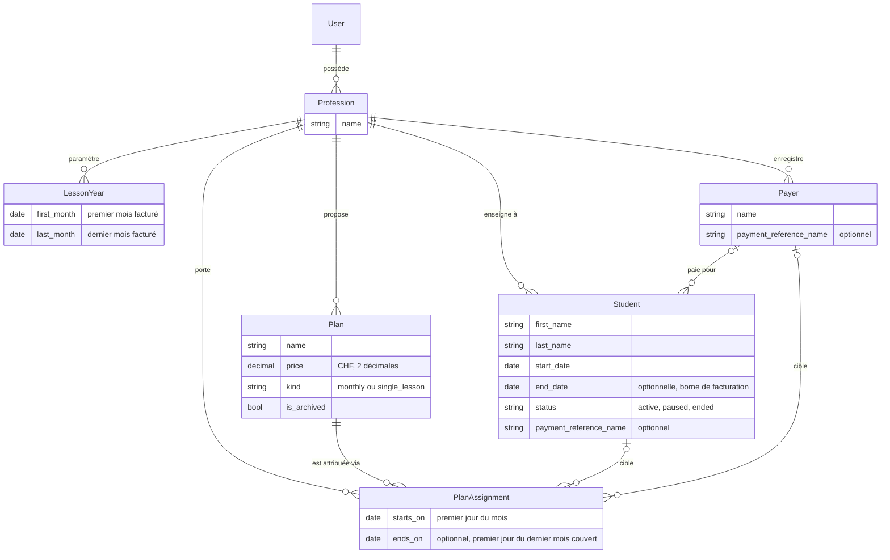
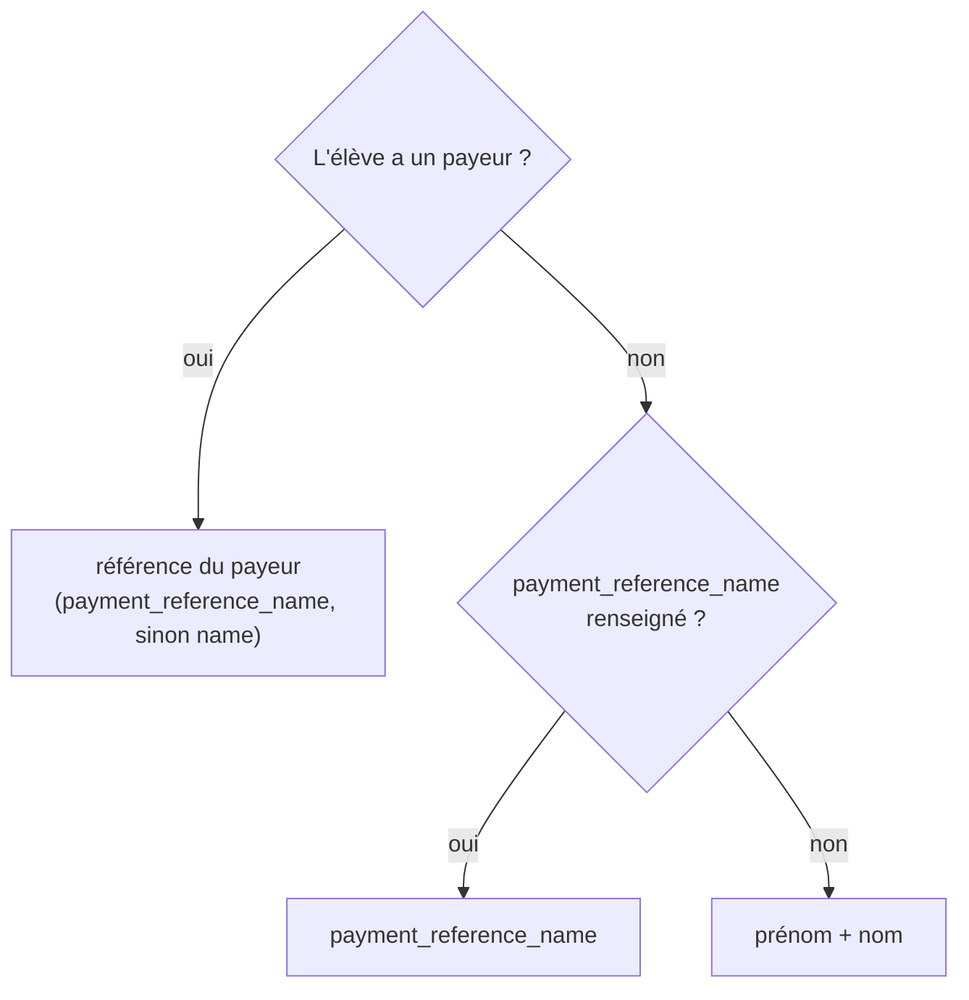
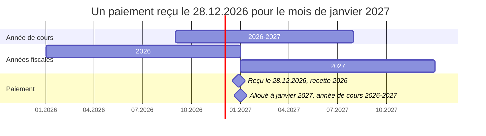

# Modèle de domaine

Le vocabulaire est fixé par le glossaire de [CLAUDE.md](../CLAUDE.md) : « activité » se dit
`Profession` dans le code, « élève » `Student`, « formule » `Plan`, « payeur » `Payer`,
« attribution de formule » `PlanAssignment`, « année de cours » `LessonYear`.

## Modèles et relations

Tout ce qui est sous `Profession` hérite de `ProfessionOwnedModel`. Les clés étrangères sont
en suppression protégée : on ne perd jamais de données par cascade.

Les mois sont toujours représentés par le premier jour du mois (`date(2026, 9, 1)` pour
septembre 2026). Les helpers de `core/utils/months.py` (`month_start`, `month_add`,
`month_span`, `month_range`) sont la seule arithmétique de mois autorisée.

## Élève

- `start_date` est obligatoire ; `end_date` est facultative et doit être postérieure ou égale.
- **`end_date` est la borne de facturation qui fait foi.** `status` est informatif : `ended`
  exige une date de fin, mais `active` ou `paused` peuvent porter une date de fin future
  (départ annoncé). L'effet de « en pause » sur les paiements attendus sera décidé avec la
  gestion des paiements. La fiche affiche un avertissement si la date de fin est passée alors
  que le statut n'est pas `ended`.
- Un élève ne se supprime pas : on lui donne une date de fin et le statut `ended`.
- La liste par défaut montre les élèves `active` et `paused` ; les élèves terminés restent
  accessibles par le filtre.

### Nom de référence pour les paiements

C'est le nom qui sera rapproché des virements bancaires. Il se résout ainsi (`Student.reference_name`) :

Le payeur l'emporte toujours, avec ou sans formule famille : c'est lui qui vire l'argent.

## Formule

- `kind` vaut `monthly` (mensuelle) ou `single_lesson` (cours à la carte). Une formule à la
  carte peut être attribuée à un élève, jamais à un payeur, et ne produira jamais de paiement
  attendu.
- Le nom est unique par activité ; le prix est un `Decimal` à deux décimales, jamais un
  `float`.
- Une formule déjà attribuée ne se supprime pas, elle s'archive. Une formule archivée reste
  visible dans les historiques mais n'est plus proposée à l'attribution.
- Il n'y a pas d'historique des prix : les enregistrements qui portent un montant (paiements
  attendus, écritures) en garderont une copie au moment de leur création.

## Payeur et formule famille

Un payeur regroupe plusieurs élèves, typiquement un parent. Il peut porter une **formule
famille**, qui est une formule mensuelle attribuée au payeur plutôt qu'à un élève.

**La formule famille et les formules individuelles coexistent** : un payeur peut avoir une
formule famille tandis qu'un de ses enfants a en plus une formule propre (par exemple un cours à
la carte). Les paiements attendus s'additionneront. Aucune règle d'exclusivité n'est imposée.

Un payeur ne se supprime que s'il n'a plus ni élève rattaché ni attribution.

## Attribution de formule

Une attribution (`PlanAssignment`) lie une formule à **une seule cible**, élève ou payeur
(contrainte de base de données), à partir d'un mois. L'historique d'une cible est la suite de
ses attributions ; une seule peut commencer un mois donné.

| Formule                       | Du             | Au             |
|-------------------------------|----------------|----------------|
| Formule bimensuelle           | décembre 2026  | en cours       |
| Nouvelle formule hebdomadaire | septembre 2026 | novembre 2026  |

Le service `plan_assign` applique les règles de changement :

Deux corrections sont possibles :

- **Terminer** la dernière attribution à un mois donné (`plan_assignment_end`). Indispensable
  pour une formule famille, puisqu'un payeur n'a pas de date de fin.
- **Supprimer** la dernière attribution (`plan_assignment_remove_latest`). L'attribution
  précédente est rouverte seulement si c'est ce changement qui l'avait fermée, c'est-à-dire si
  elle se terminait le mois d'avant. Une attribution terminée à la main reste terminée. La règle
  vit dans le selector `plan_assignment_reopened_by_removal`, utilisé à la fois par le service
  et par la fenêtre de confirmation, qui annonce ainsi exactement ce qui va se passer.

La formule courante d'un élève pour un mois est celle de l'attribution qui couvre ce mois ;
elle est nulle une fois la date de fin de l'élève dépassée (`student_current_plan`).

## Année de cours et année fiscale

Ces deux périodes ne doivent jamais être mélangées.

- L'**année de cours** (`LessonYear`, par activité) va d'un premier mois à un dernier mois
  facturés, par exemple septembre 2026 à juillet 2027. Elle compte entre 1 et 12 mois et ne
  chevauche aucune autre année de la même activité. Son nom est dérivé : « 2026-2027 ». Elle
  servira aux paiements attendus, à l'allocation des paiements aux mois et aux arriérés.
- L'**année fiscale** est l'année civile. Une recette appartient à l'année de sa date de
  réception, une dépense à l'année de sa date de paiement. Elle servira au compte
  d'exploitation et aux statistiques financières.

Les selectors nomment la période qu'ils manipulent (`lesson_year_for_month`, et plus tard
`income_for_fiscal_year`). L'année de cours affichée par défaut (`lesson_year_current`) est
celle qui contient le mois courant ; entre deux années, la prochaine ; après la dernière
configurée, la plus récente.

## À venir

Les paiements attendus, les écritures comptables, les dépenses, l'import bancaire et le
rapprochement sont décrits dans [SPECS.md](../SPECS.md) et seront documentés ici tranche par
tranche.
