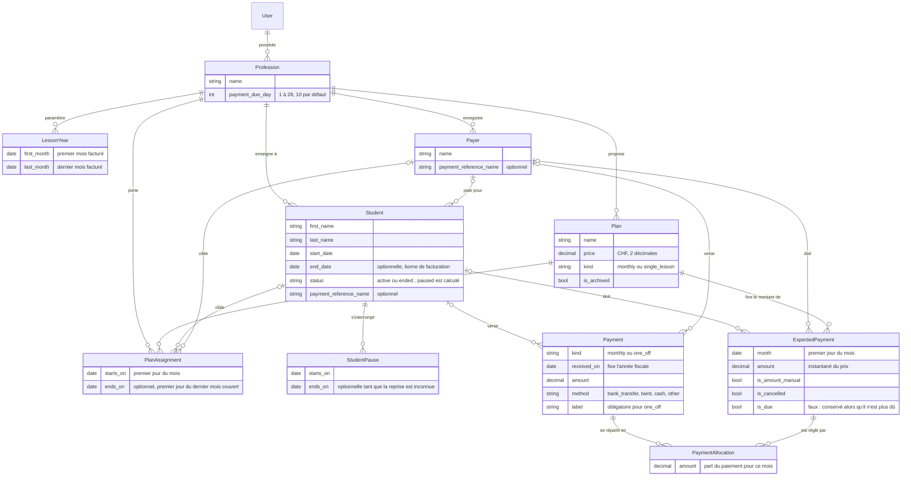
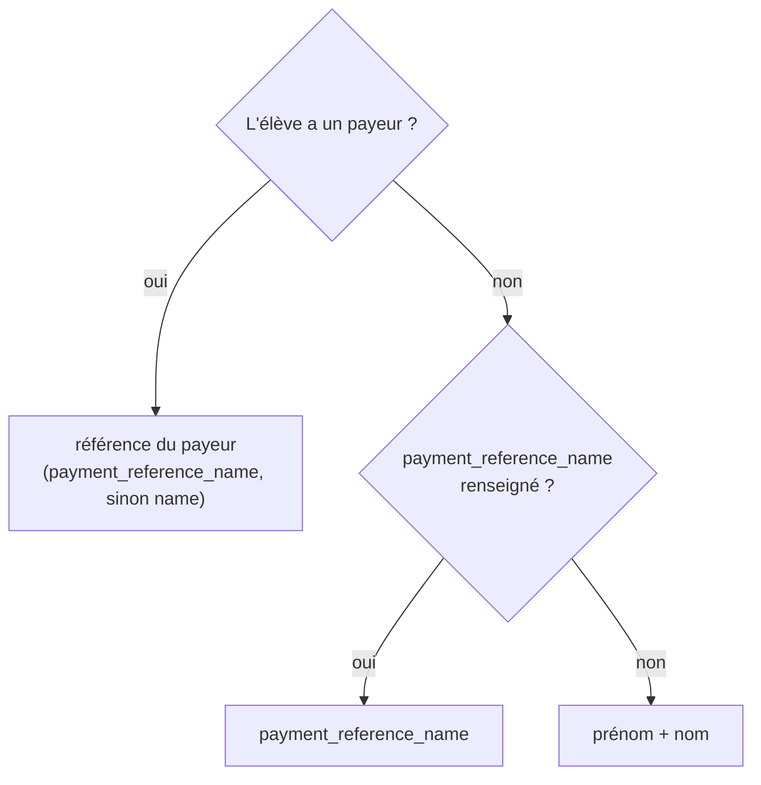
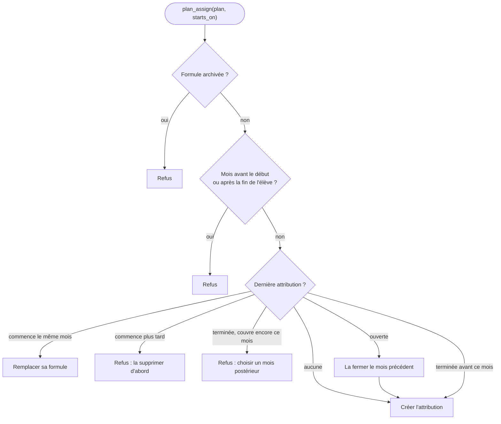
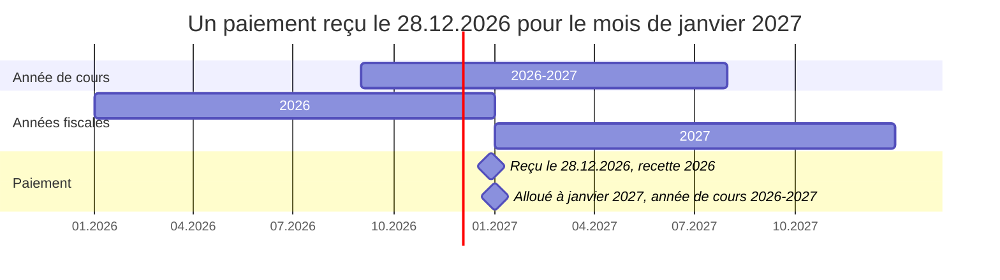
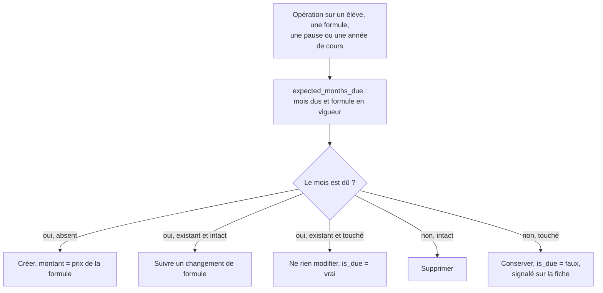

# Modèle de domaine

Le vocabulaire est fixé par le glossaire de [CLAUDE.md](../CLAUDE.md) : « activité » se dit
`Profession` dans le code, « élève » `Student`, « formule » `Plan`, « payeur » `Payer`,
« attribution de formule » `PlanAssignment`, « année de cours » `LessonYear`, « pause »
`StudentPause`, « paiement attendu » `ExpectedPayment`, « paiement » ou « recette » `Payment`.

## Modèles et relations

Tout ce qui est sous `Profession` hérite de `ProfessionOwnedModel`, sauf `PaymentAllocation`,
qui appartient à son paiement. Les clés étrangères sont en suppression protégée : on ne perd
jamais de données par cascade. Deux exceptions voulues : supprimer un paiement supprime ses
attributions (c'est ce qui libère les mois), et une pause n'existe pas sans son élève.

Les mois sont toujours représentés par le premier jour du mois (`date(2026, 9, 1)` pour
septembre 2026). Les helpers de `core/utils/months.py` (`month_start`, `month_add`,
`month_span`, `month_range`) sont la seule arithmétique de mois autorisée.

## Élève

- `start_date` est obligatoire ; `end_date` est facultative et doit être postérieure ou égale.
- **`end_date` est la borne de facturation qui fait foi.** `status` est informatif et ne
  stocke que `active` ou `ended` : `ended` exige une date de fin, `active` peut porter une
  date de fin future (départ annoncé). La fiche affiche un avertissement si la date de fin
  est passée alors que le statut n'est pas `ended`.
- **« En pause » se calcule.** Le selector `student_status` renvoie `paused` quand une
  `StudentPause` couvre la date du jour ; `Student.clean` refuse de stocker cette valeur. Le
  filtre de la liste applique la même règle en base (`Exists` sur les pauses en cours).
- Un élève ne se supprime pas : on lui donne une date de fin et le statut `ended`.
- La liste par défaut montre les élèves `active` et `paused` ; les élèves terminés restent
  accessibles par le filtre.

### Nom de référence pour les paiements

C'est le nom qui sera rapproché des virements bancaires. Il se résout ainsi (`Student.reference_name`) :

Le payeur l'emporte toujours, avec ou sans formule famille : c'est lui qui vire l'argent.

## Formule

- `kind` vaut `monthly` (mensuelle) ou `single_lesson` (cours à la carte). Une formule à la
  carte peut être attribuée à un élève, jamais à un payeur, et ne produira jamais de paiement
  attendu.
- Le nom est unique par activité ; le prix est un `Decimal` à deux décimales, jamais un
  `float`.
- Une formule déjà attribuée ne se supprime pas, elle s'archive. Une formule archivée reste
  visible dans les historiques mais n'est plus proposée à l'attribution.
- Il n'y a pas d'historique des prix : les enregistrements qui portent un montant (paiements
  attendus, écritures) en garderont une copie au moment de leur création.

## Payeur et formule famille

Un payeur regroupe plusieurs élèves, typiquement un parent. Il peut porter une **formule
famille**, qui est une formule mensuelle attribuée au payeur plutôt qu'à un élève.

**La formule famille et les formules individuelles coexistent** : un payeur peut avoir une
formule famille tandis qu'un de ses enfants a en plus une formule propre (par exemple un cours à
la carte). Les paiements attendus s'additionneront. Aucune règle d'exclusivité n'est imposée.

Un payeur ne se supprime que s'il n'a plus ni élève rattaché ni attribution.

## Attribution de formule

Une attribution (`PlanAssignment`) lie une formule à **une seule cible**, élève ou payeur
(contrainte de base de données), à partir d'un mois. L'historique d'une cible est la suite de
ses attributions ; une seule peut commencer un mois donné.

| Formule                       | Du             | Au             |
|-------------------------------|----------------|----------------|
| Formule bimensuelle           | décembre 2026  | en cours       |
| Nouvelle formule hebdomadaire | septembre 2026 | novembre 2026  |

Le service `plan_assign` applique les règles de changement :

Deux corrections sont possibles :

- **Terminer** la dernière attribution à un mois donné (`plan_assignment_end`). Indispensable
  pour une formule famille, puisqu'un payeur n'a pas de date de fin.
- **Supprimer** la dernière attribution (`plan_assignment_remove_latest`). L'attribution
  précédente est rouverte seulement si c'est ce changement qui l'avait fermée, c'est-à-dire si
  elle se terminait le mois d'avant. Une attribution terminée à la main reste terminée. La règle
  vit dans le selector `plan_assignment_reopened_by_removal`, utilisé à la fois par le service
  et par la fenêtre de confirmation, qui annonce ainsi exactement ce qui va se passer.

La formule courante d'un élève pour un mois est celle de l'attribution qui couvre ce mois ;
elle est nulle une fois la date de fin de l'élève dépassée (`student_current_plan`).

## Année de cours et année fiscale

Ces deux périodes ne doivent jamais être mélangées.

- L'**année de cours** (`LessonYear`, par activité) va d'un premier mois à un dernier mois
  facturés, par exemple septembre 2026 à juillet 2027. Elle compte entre 1 et 12 mois et ne
  chevauche aucune autre année de la même activité. Son nom est dérivé : « 2026-2027 ». Elle
  servira aux paiements attendus, à l'allocation des paiements aux mois et aux arriérés.
- L'**année fiscale** est l'année civile. Une recette appartient à l'année de sa date de
  réception, une dépense à l'année de sa date de paiement. Elle servira au compte
  d'exploitation et aux statistiques financières.

Les selectors nomment la période qu'ils manipulent (`lesson_year_for_month`,
`expected_payments_for_lesson_year`, `income_for_fiscal_year`). L'année de cours affichée par défaut (`lesson_year_current`) est
celle qui contient le mois courant ; entre deux années, la prochaine ; après la dernière
configurée, la plus récente.

## Pauses

Une pause (`StudentPause`) a un début et une fin en dates ; la fin reste vide tant que la
reprise n'est pas connue. Les pauses d'un élève ne se chevauchent pas : la règle compare
plusieurs enregistrements, elle vit donc dans `_student_pause_validate` (services).

Seul un mois **entièrement** compris dans une pause n'est pas attendu
(`StudentPause.covers_whole_month`) : faute de prorata, un mois entamé reste dû en entier.
La pause d'un élève ne touche pas la formule famille de son payeur.

## Paiements attendus

Un `ExpectedPayment` est le montant dû pour un mois facturé par un élève ou, pour une formule
famille, par un payeur. Personne ne les saisit : `expected_payments_sync` les calcule.

- **Mois dus** (`expected_months_due`) : les mois des années de cours paramétrées, du mois de
  la date de début au mois de la date de fin, couverts par une formule mensuelle, hors mois
  entièrement en pause. Une formule famille suit uniquement son attribution au payeur. Une
  formule à la carte ne crée jamais de paiement attendu.
- **Intact** : sans attribution de paiement, non annulé, montant non modifié à la main. Un
  mois intact est une donnée calculée, que la synchronisation peut modifier ou supprimer. Un
  mois touché n'est jamais modifié automatiquement.
- **Instantané** : `amount` copie le prix à la création. Modifier le prix d'une formule ne
  réécrit rien ; seul un changement de formule met à jour les mois intacts.
- La synchronisation est appelée par les services qui changent ce qui est dû :
  `student_update`, `plan_assign`, `plan_assignment_end`, `plan_assignment_remove_latest`,
  `student_pause_*`, `lesson_year_create`, `lesson_year_update`, ainsi qu'après la
  suppression ou la modification d'un paiement et le rétablissement d'un mois annulé.

### Statut d'un mois

Le statut n'est pas stocké : `month_line_build` le calcule à partir des attributions, du
jour limite de l'activité (`Profession.payment_due_day`) et de la date du jour. Seule
l'annulation est enregistrée (`is_cancelled`, avec un motif facultatif).

| Statut               | Condition                                                          |
|----------------------|--------------------------------------------------------------------|
| `cancelled`          | `is_cancelled` ; le mois n'est plus dû                             |
| `paid`               | les attributions couvrent le montant ; « payé en retard » si le dernier paiement est reçu après le jour limite |
| `partially_paid`     | une partie seulement est attribuée                                 |
| `late`               | rien d'attribué et le jour limite est dépassé                      |
| `unpaid`             | rien d'attribué et le jour limite n'est pas dépassé                |

Changer le jour limite recalcule donc le retard de tous les mois, passés compris. Un arriéré
est un mois dû et non soldé d'une année de cours antérieure à celle affichée.

## Paiements et attribution aux mois

Un `Payment` est de l'argent réellement reçu. Il en existe deux types.

- **Mensualité** (`monthly`) : vise un seul élève, ou un seul payeur pour une formule famille,
  et se répartit sur des mois par des `PaymentAllocation`. Ce qui n'est pas attribué est un
  avoir non attribué (`unallocated_credit_list`).
- **Recette ponctuelle** (`one_off`) : cours à la carte ou bon cadeau, avec un libellé libre
  et un élève facultatif. Elle n'est jamais attribuée à un mois.

`payment_allocation_propose` propose la répartition, sans rien écrire :

1. l'année de cours concernée est celle du mois de réception, sinon la suivante (paiement
   reçu en août) ; s'il n'y en a pas, rien n'est attribué ;
2. les mois ouverts de cette année sont servis du plus ancien au plus récent, par
   mensualités entières ;
3. un montant inférieur au premier mois ouvert est proposé en paiement partiel ;
4. le reste devient un avoir ; les arriérés des années précédentes ne sont jamais proposés.

La proposition porte des avertissements (`AllocationWarning`) : paiement partiel, avoir,
arriéré existant, aucune année de cours. Pour un payeur, un versement partiel est normal et
ne déclenche pas d'avertissement. L'import bancaire s'appuiera sur ces avertissements pour
signaler un paiement « à vérifier ».

Les services `payment_create` et `payment_update` reçoivent les parts confirmées par
l'utilisateur et les vérifient : mois du même élève ou payeur, non annulé, part au plus égale
au reste dû, somme au plus égale au paiement.

## Écritures comptables et année fiscale

Il n'y a pas de table d'écritures. Une écriture (`LedgerEntry`) est une dataclass produite par
`ledger_entry_list` à partir des paiements, et plus tard des dépenses : une écriture n'existe
que pour de l'argent réellement reçu ou payé, jamais pour un montant attendu.
`income_for_fiscal_year` additionne les recettes par **date de réception**.

## À venir

Les dépenses, l'import bancaire et le rapprochement sont décrits dans
[SPECS.md](../SPECS.md) et seront documentés ici tranche par tranche.
